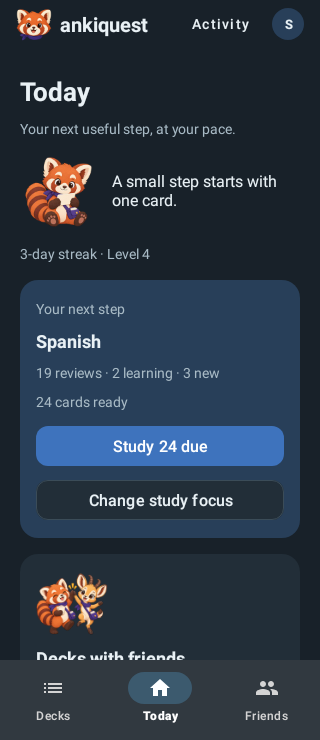
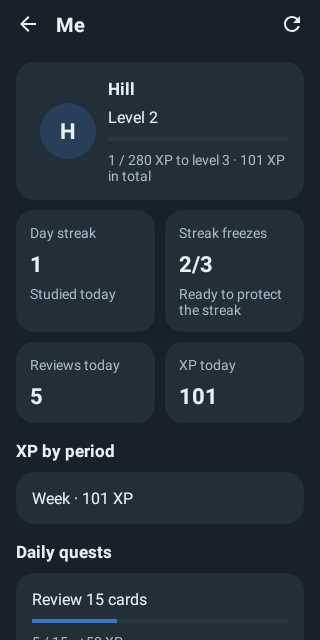

# Avatar initial contrast

The dark avatar's initial used the button accent, giving 2.26:1 contrast on its circle. Its text colour now follows the dark text palette. The light palette keeps its existing accent.

The regression checks actual view colours at the 32dp Today and 56dp profile sizes, in both themes. The dark case failed before the fix; both cases now exceed 4.5:1. Navigation and profile tests also pass.

| Screen | Before | After |
| --- | --- | --- |
| Today |  |  |
| Me |  |  |

All 16 Home/Me light and dark renders completed, including 200% text. The seven avatar contrast warnings disappeared; all eight light-theme images stayed byte-identical. Other illustration and text-rendering warnings remain under issue #142. The scanner logs warnings without failing tests and does not replace device checks.

```sh
./gradlew :AnkiDroid:testPlayDebugUnitTest \
  --tests com.ichi2.anki.ankiquest.AnkiquestAvatarContrastTest

./gradlew :AnkiDroid:testPlayDebugUnitTest \
  --tests com.ichi2.anki.ankiquest.AnkiquestHomeScreenshotTest \
  --tests com.ichi2.anki.ankiquest.AnkiquestMeScreenshotTest \
  -Pscreenshot -PaccessibilityScan -Ptheme=light,dark \
  -Proborazzi.test.record=true -PtestMaxParallelForks=1
```
