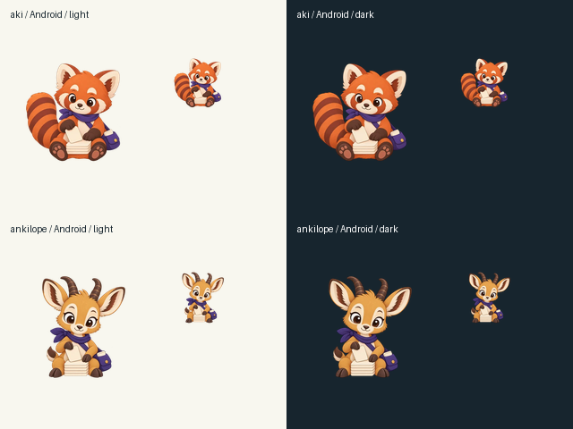

# Backlog art

Aki and Ankilope calmly sort a stack of blank flashcards. The transparent
336 × 336 WebPs are exported from the 1254 × 1254 PNG masters in the companion
server change for float3/ankiquest#88. `AnkiquestCompanion` maps the pair while
preserving the account's mascot choice, including None.

Both masters and Android exports were reviewed at native size and at 64 pixels
on light and dark backgrounds: complete limbs, ears, horns and tails, clean
visible alpha edges, no text, and readable card silhouettes. Exact generation
prompts and references are in the server's `docs/branding/aki-prompts.json`.

These are assets for backlog-specific surfaces; the current general study
artwork and goal behavior are unchanged. The Android companion must merge
before the server's exporter starts requiring the two new drawables.
