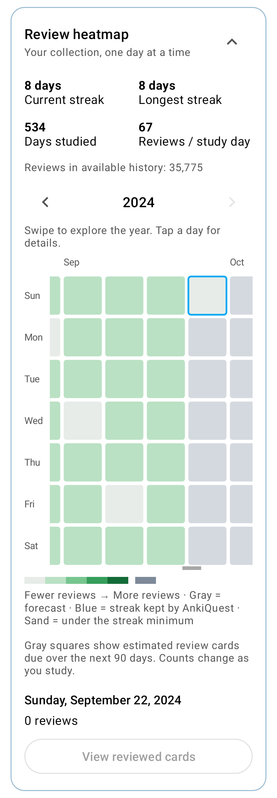
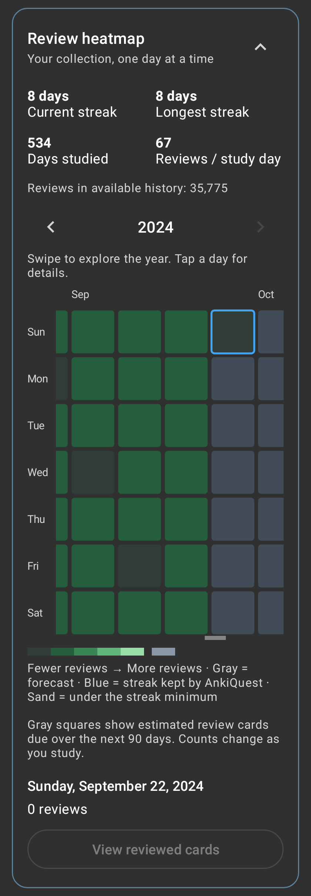
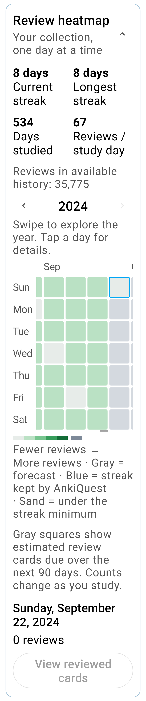
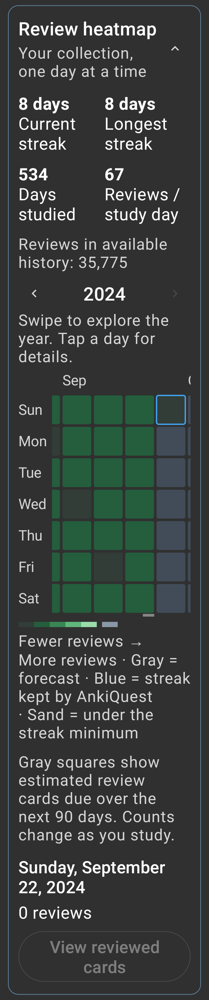

# Accessible heatmap day targets

Part of #142. Each calendar day now occupies a separate target of at least
48 × 48 dp. Its target includes the gap around the painted square. The same
bounds drive touch, accessibility and keyboard scrolling, with whole-pixel
edges so neighboring targets do not overlap. The focusable calendar host also
has the localized Review heatmap label.

The new target-size and host-label regressions were observed failing before
the fix. The complete `com.ichi2.anki.ankiquest.heatmap.*` unit-test package then
passed locally. Coverage includes all 366 leap-year targets, pairwise
non-overlap, selection from a visual gap, accessible day selection, keyboard
navigation, scrolling, and existing calendar state behavior.

`AnkiquestHeatmapScreenshotTest` records light/dark screenshots at 320 dp with
100% and 200% text. All four passed and were visually reviewed. The existing
renderer also produced ten reviewed states: light/dark at 320 and 390 dp,
150% and 200% text, empty history, loading, and failure with Retry.

The calendar scrolls horizontally, so partial columns and month headings at
the viewport edges are intentional. The larger day targets make the expanded
calendar taller; its enclosing screen remains vertically scrollable.

This is automated node-bound and screenshot evidence, not a physical-device
Accessibility Scanner or TalkBack sign-off. Those checks and the other #142
screens remain open.
