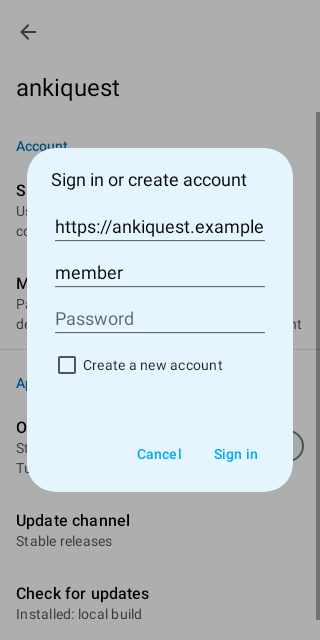
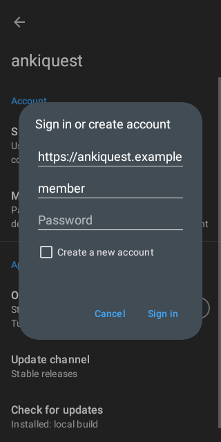
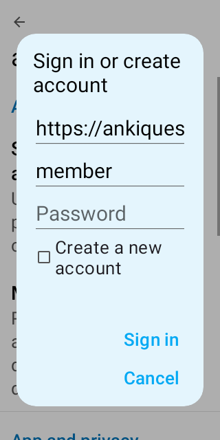
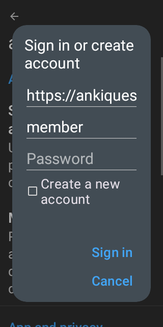

# Sign-in username prefill

`AnkiquestLoginScreenshotTest` captures the sign-in dialog after a local sign-out.
The previous username is suggested; the password remains empty.

All four renders were reviewed at 320 × 640 dp in light and dark themes, with
normal and 200% text. The form and both actions remain visible. At 200% text,
the single-line server field scrolls horizontally as before.

```shell
./gradlew :AnkiDroid:testPlayDebugUnitTest -Pscreenshot -Ptheme=light,dark -Proborazzi.test.record=true --tests com.ichi2.anki.preferences.AnkiquestLoginScreenshotTest
```

| Text | Light | Dark |
| --- | --- | --- |
| Normal |  |  |
| 200% |  |  |

No physical-device Accessibility Scanner result is claimed.
