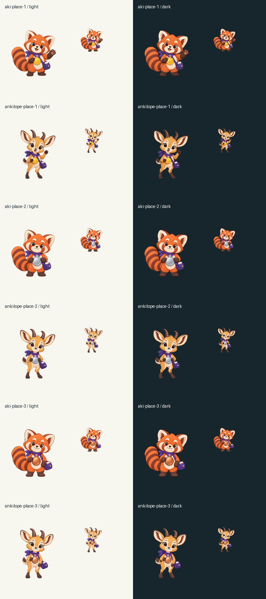

# Weekly podium artwork

Six matching Aki/Ankilope poses replace the generic weekly-place aliases.
Gold uses a friendly wave, silver holds the medal, and bronze has a relaxed
smile. Rank remains ordinary translated UI text; the medals have no text.

The 1254px transparent PNG masters, exact prompts and references live in
`float3/ankiquest` under `static/{aki,ankilope}/place_{1,2,3}.png` and
`docs/branding/aki-prompts.json`. Its existing exporter writes the 336px
Android WebPs for 112dp moment art. All masters and exports were reviewed
at native size and 64/128px on both backgrounds. Full ears, horns, tails
and feet remain inside the canvas, with no visible matte or stray marks.

Merge this Android companion before the server exporter registration.
The current art check accepts extra files; the new exporter requires them.
