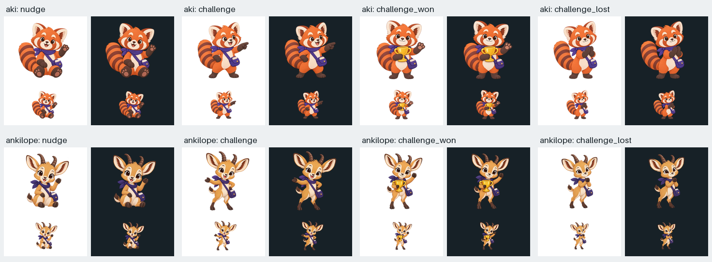

# Social companion art

Nudges, challenge invitations and completed challenges now use their matching
poses. The chosen companion gets the same pose. Challenge-lost art is included
for an explicit losing result; this change does not infer one from completion.

The eight 336 px WebPs come from the transparent masters and recorded prompts
in [server PR #237](https://github.com/float3/ankiquest/pull/237), commit
`660e119bee68d56b0e6e6a646eae66b657130f8f`. All 38 drawables match that exporter
byte for byte; the existing 30 files are unchanged.

The sheet uses the actual Android exports. The original masters were also
reviewed at native size. The updated companion and nudge expectations failed
against the old mappings before the implementation changed. Account-scoped
companion selection and the option to hide mascot art remain covered.

Merge the Android assets before the server catalog change so the art check
continues to pass. Physical-device notification rendering was not checked.
