# Streak widget progress and states

Issue #168: daily-goal progress, pending-upload appearance, semantic state colors and minimum-size layout fitting. These captures use native Android 13 font metrics and the exact minimum sizes: 57 × 57, 100 × 90, 200 × 220 and 300 × 380 dp.

Each state grid has these pairs, from top to bottom:

1. Partial minimum / minimum met with a 12-of-20-card goal.
2. Protected / no streak.
3. Local minimum awaiting upload / unknown current-day status.

The tier grids cover 1/7, 30/100 and 365/1000 days. There is no daily goal in those grids.

| Size | States, light | States, dark | Tiers, light | Tiers, dark |
| --- | --- | --- | --- | --- |
| Small | 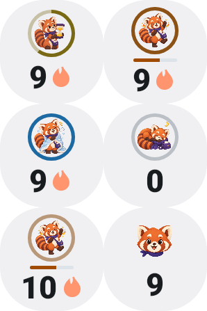 | 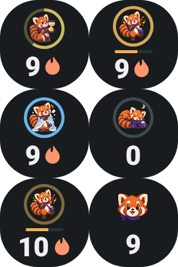 | 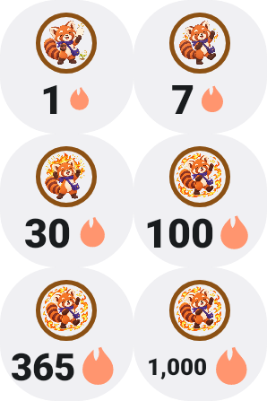 | 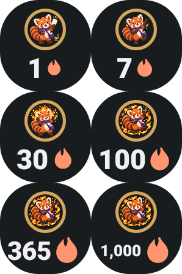 |
| Medium | 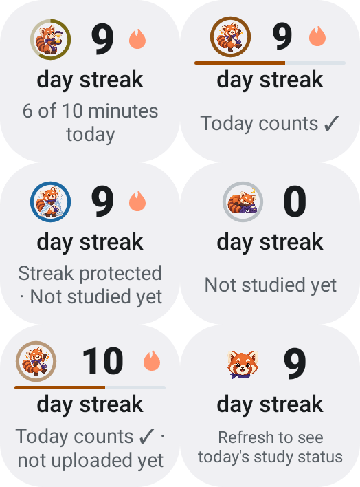 | 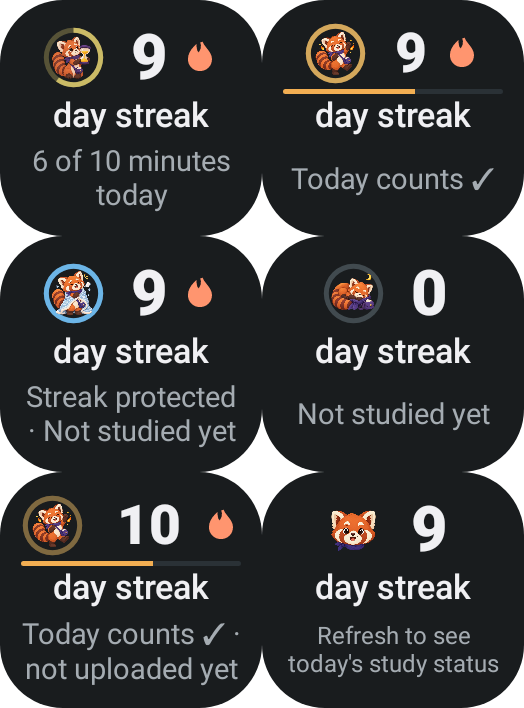 | 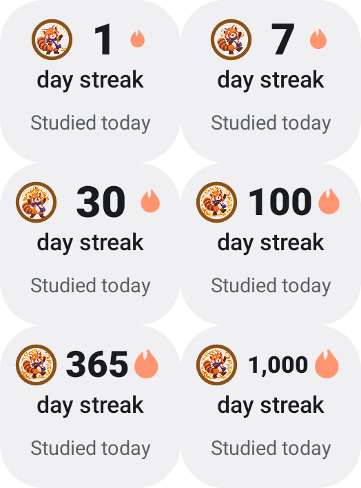 | 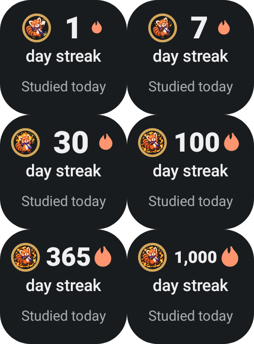 |
| Large | 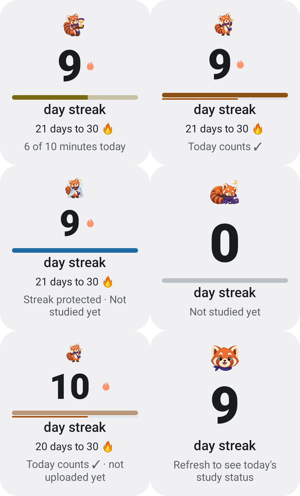 | 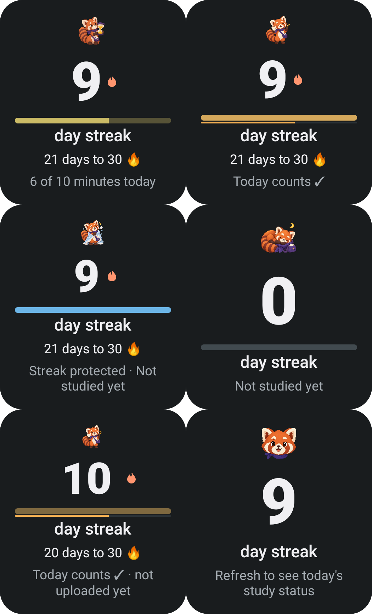 | 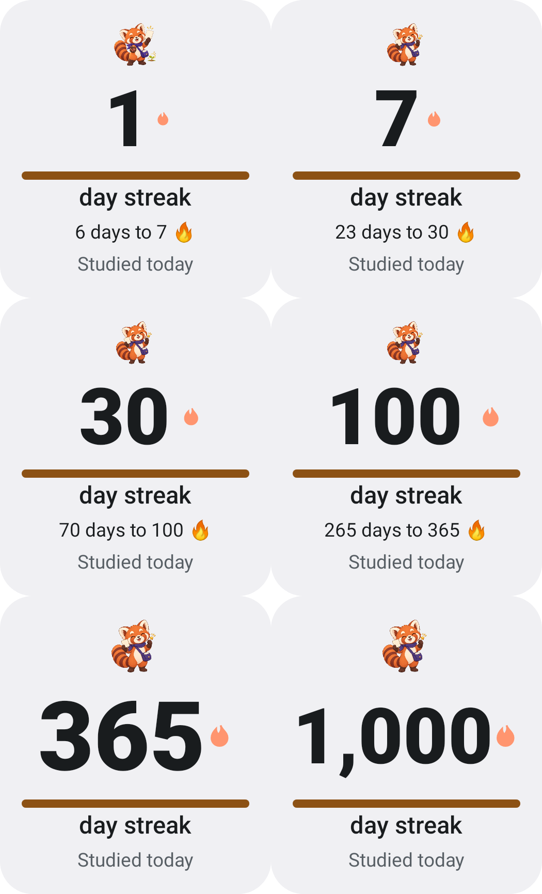 | 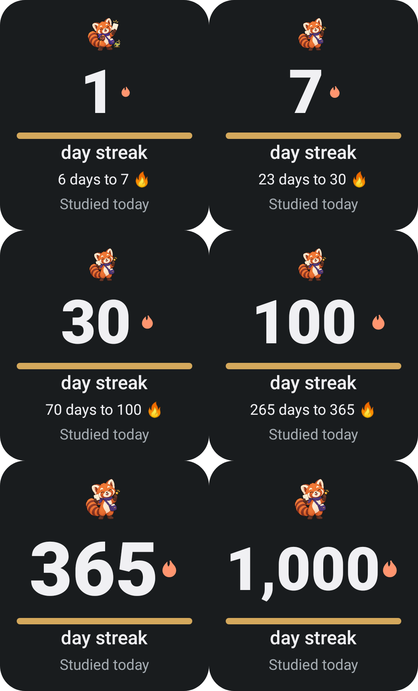 |
| Huge | 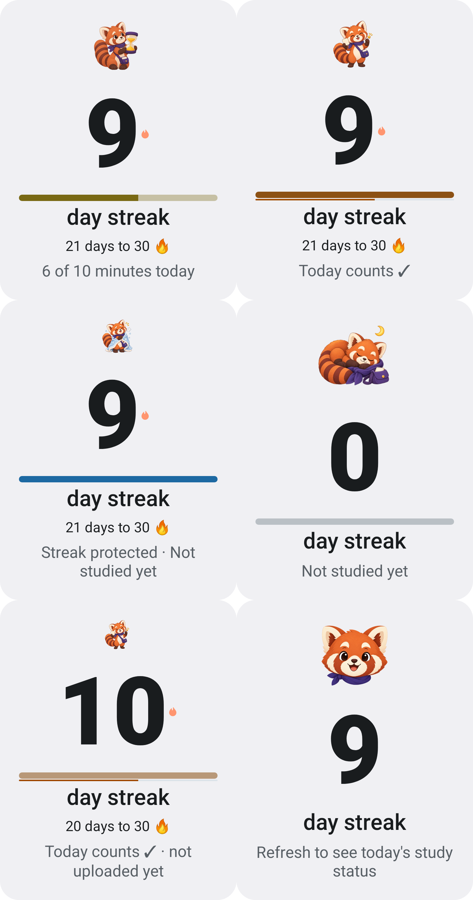 | 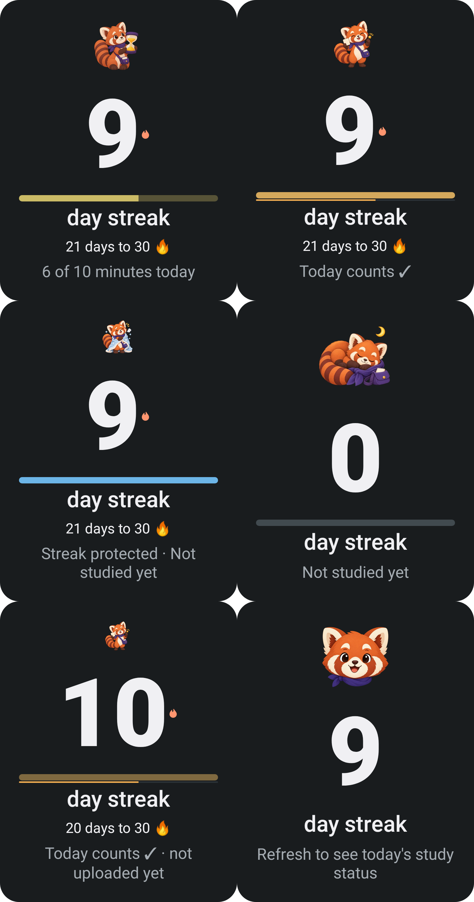 | 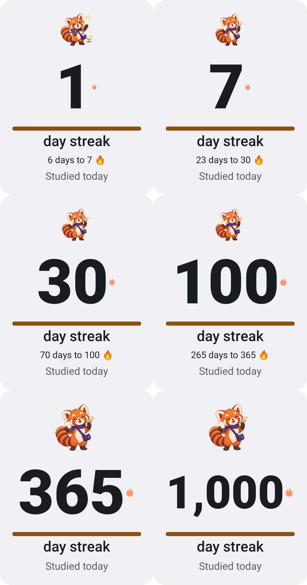 | 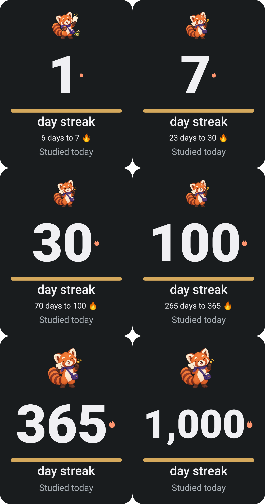 |

The tests check complete status text, visible numbers and companions, goal bounds and the smallest card's rounded outline. Colors are never the only state cue: status text and the root's TalkBack description retain the full verdict and known progress. On older Android, the compact text is fitted to its minimum available area; the fallback is tested with native fonts in all five AnkiQuest languages.

Reproduce on an Android SDK/JDK setup:

```sh
./gradlew :AnkiDroid:testPlayDebugUnitTest \
  --tests 'com.ichi2.anki.ankiquest.AnkiquestStreakScreenshotTest' \
  --tests 'com.ichi2.anki.ankiquest.AnkiquestStreakDetailsScreenshotTest' \
  -Pscreenshot -Ptheme=light,dark -Proborazzi.test.record=true -PtestMaxParallelForks=1
```

On PowerShell, quote the complete `-Proborazzi.test.record=true` argument. Physical launcher sharpness and TalkBack/Accessibility Scanner checks remain outstanding. The optional week strip and transparent widget are separate remaining items in #168.
